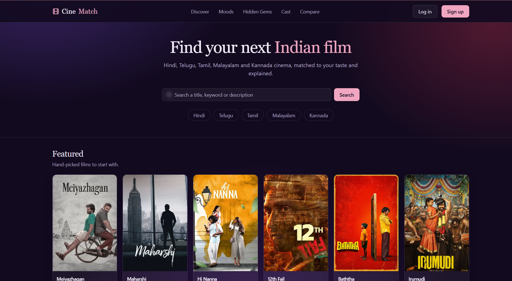
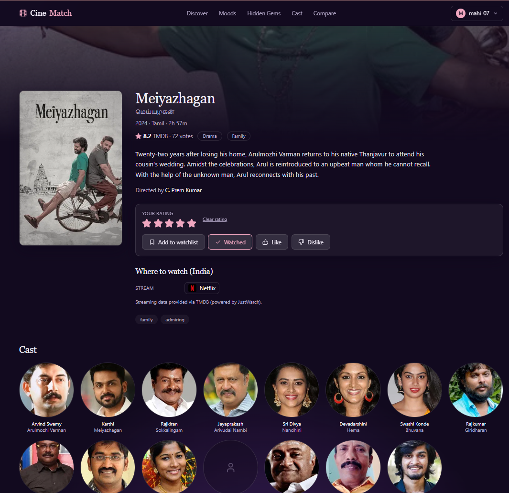
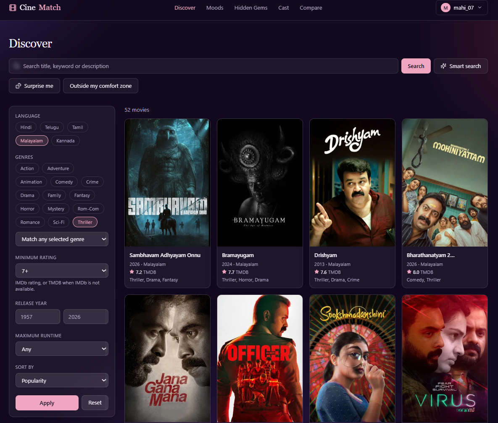
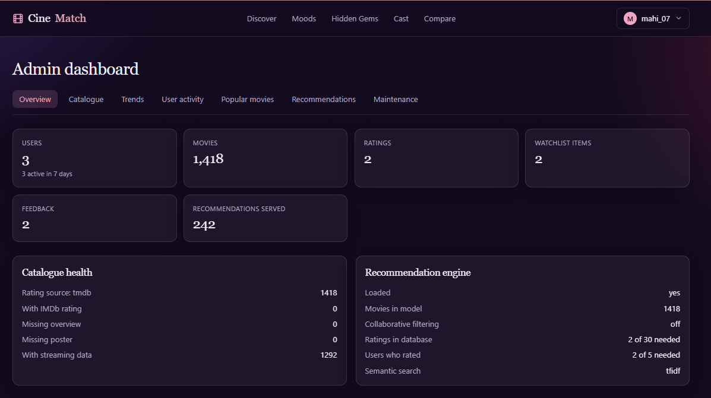
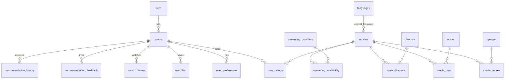

# CineMatch: AI-powered Indian movie recommendations

A full-stack recommender for Hindi, Telugu, Tamil, Malayalam and Kannada cinema. Users filter by
language, genre, rating, cast and year, pick a mood, search in natural language, and get
**explained** recommendations from a hybrid machine-learning engine.

**Stack:** React, Vite, Tailwind CSS, Recharts | FastAPI, SQLAlchemy, Pydantic | MySQL |
NumPy, pandas, scikit-learn (TF-IDF, SVD) | Docker | pytest

## Screenshots






## Features

- **Multi-filter discovery:** language, multiple genres (any/all), minimum rating, release year,
  runtime and keywords, all combinable
- **Hybrid recommender:** content-based (TF-IDF + cosine similarity), collaborative (SVD), weighted
  popularity, configurable weights, cold-start handling and MMR diversity
- **Hard filters first:** filters run in SQL before ranking, so a selected language or minimum
  rating is never violated
- **Explainable results:** every recommendation lists the real signals behind it; match % comes
  from actual scores
- **Mood picker** (8 moods), **hidden-gems finder** (credible votes + modest popularity),
  **surprise me** (including outside your comfort zone), **similar movies**, **side-by-side comparison**
- **Natural-language search:** language, genre, year and rating cues in the query become hard
  filters; the rest is matched against movie descriptions
- **Actor and actress search,** filmographies with filters, and "movies together" for two people
- **Accounts and personalisation:** favourites, ratings, watchlist, watched history, likes and
  dislikes, comments, recently viewed and a taste profile
- **Admin dashboard:** catalogue health, user activity, language and genre trends,
  recommendation analytics, model retraining and TMDB ingestion
- **Streaming availability** only when TMDB returns verified India data. Nothing is guessed.
- **Honest ratings:** every rating shows its source (IMDb or TMDB)

## Architecture

```
React (Vite) --/api--> FastAPI: routers -> services -> repositories --> MySQL
                              \-> ml/ package (TF-IDF, SVD, MMR, explanations)
TMDB API --ingest script--> MySQL          ml/train.py --> ml/artifacts/
```

Routers stay thin, services hold business logic, and repositories are the only layer that queries
the database. Models are trained offline, saved to `ml/artifacts/`, and loaded once at API startup.



18 normalised tables with primary keys, foreign keys, unique constraints and indexes.

## Recommendation engine

1. **Candidates:** the hard filters become SQL conditions.
2. **Scores per candidate:**
   - *Content:* the user's profile (built from ratings, likes and watchlist) against TF-IDF vectors
     of genres, cast, director, keywords and overview
   - *Collaborative:* SVD on mean-centred user ratings
   - *Popularity:* Bayesian weighted rating
   - *Preference:* match with declared favourite languages and genres

   Each score is min-max normalised within the candidate pool.
3. **Hybrid:** a weighted sum. Weights are configurable in `.env` and adapt per user.
   Collaborative filtering stays off until at least 30 ratings from at least 5 users exist, and
   ramps up as a user rates more movies. New users are served from their declared preferences
   plus popularity.
4. **Diversity:** MMR re-ranking avoids near-identical results.
5. **Explanation:** reasons are generated only from signals that actually contributed.

## Evaluation (real results)

All evaluations use a per-user temporal split (each user's latest ratings held out) and fit every
model on training data only. Data: MovieLens 32M restricted to catalogue movies matched through
TMDB ids. Relevant = rated 4 or higher. Reports with 95% bootstrap confidence intervals are in
[`documentation/ml-report.md`](documentation/ml-report.md) and
[`documentation/ml-tuning.md`](documentation/ml-tuning.md).

### Baseline comparison (first run: 334-movie pool, 302 users, 1,046 relevant held-out movies)

| Model | NDCG@10 | Catalogue coverage |
|---|---|---|
| Popularity | 0.186 | 9% |
| Collaborative (SVD) | 0.124 | 44% |
| Hybrid (untuned weights) | 0.097 | 62% |
| Content | 0.054 | 64% |
| Random | 0.029 | 100% |

- Every model beats random.
- Popularity scores highest on accuracy. This is expected on observational data where users mostly
  rate popular films, but popularity recommends nearly the same films to everyone (9% coverage), so
  it is not personalised.

### Weight tuning (936-movie pool, 341 users)

Weights were chosen on a **validation** split (60% train / 20% validation / 20% test per user) and
the **test** split was used once, afterwards.

| Model | Test NDCG@10 (95% CI) |
|---|---|
| Hybrid, original weights (content 0.5, collab 0.3, pop 0.2) | 0.069 [0.054, 0.084] |
| Hybrid, tuned weights (content 0, collab 0.75, pop 0.25) | 0.134 [0.115, 0.156] |
| Popularity baseline | 0.130 [0.110, 0.150] |

- Tuning improved the hybrid by +0.066 NDCG@10 per user (95% CI +0.042 to +0.086), a measurable gain.
- The tuned hybrid is **not distinguishable from the popularity baseline** in this test (the
  intervals overlap), so no advantage over popularity is claimed.
- The validation search put zero weight on the TF-IDF content model, meaning that on this
  MovieLens data it did not help ranking accuracy. Content similarity is still used for the
  Similar movies, mood and search features.
- MovieLens users are general audiences, not specifically Indian-cinema viewers, so results on
  real CineMatch users may differ. `python -m ml.evaluate --source db` measures that once real
  ratings exist.

Regenerate with:

```
python -m ml.evaluate --source movielens --path dataset/raw/ml-32m
python -m ml.tune --path dataset/raw/ml-32m
```

## Run locally (Windows PowerShell)

```powershell
copy .env.example .env                      # then edit the passwords and the JWT secret
docker compose up -d db
python -m venv .venv
.\.venv\Scripts\Activate.ps1
python -m pip install -r backend\requirements.txt
python -m backend.app.db.init_db
python -m backend.scripts.ingest_tmdb --pages 5     # needs TMDB_API_KEY (use a VPN if blocked)
python -m ml.train
uvicorn backend.app.main:app --reload --port 8000
```

In a second terminal:

```powershell
cd frontend
npm install
npm run dev
```

Open http://localhost:5173 (API docs at http://127.0.0.1:8000/docs).

Create an admin account:

```powershell
python -m backend.scripts.create_admin --email you@example.com --username admin --password YourPassword
```

Optional: add real IMDb ratings with `python -m backend.scripts.enrich_omdb` (needs `OMDB_API_KEY`).

## Docker (full stack)

```powershell
docker compose --profile app up -d --build      # app on http://localhost:8080
```

After the first start, log in as an admin and click **Admin, Maintenance, Retrain now** to build
the model files inside the container.

## Tests

```powershell
python -m pytest backend\tests -q
```

Covers authentication, hard filters, ratings, watchlist, comments, the admin lock, the hybrid
recommender, MMR, hidden gems, query parsing and the evaluation metrics.

## Project structure

```
CineMatch/
  backend/         FastAPI app: routers, schemas, models, services, repositories, scripts, tests
  frontend/        React app: pages, components, API client
  ml/              TF-IDF, SVD, hybrid, MMR, explanations, evaluation, tuning
  dataset/         MovieLens goes in dataset/raw (not committed)
  documentation/   ML evaluation and tuning reports
```

## Limitations

- The catalogue contains only what was ingested from TMDB. Very recent or low-vote films may be
  missing until more pages are ingested.
- Ratings are TMDB ratings unless the optional OMDb script has been run. Every rating shows its source.
- Natural-language search uses TF-IDF word matching by default. Sentence Transformers is supported
  if installed but is not required.
- Collaborative filtering in the live app switches on only after enough real user ratings exist.
  Until then recommendations use preferences and popularity (plus content, if its weight is above 0).
- "Movies together" uses the top 15 billed cast of each movie.
- Dubbed languages are stored but empty, because TMDB does not provide them reliably.
- The evaluation uses MovieLens users, who are not specifically Indian-cinema audiences.

## Credits

This product uses the TMDB API but is not endorsed or certified by TMDB. Streaming data is provided
through TMDB (powered by JustWatch). Evaluation uses the MovieLens dataset (GroupLens, non-commercial
research use).